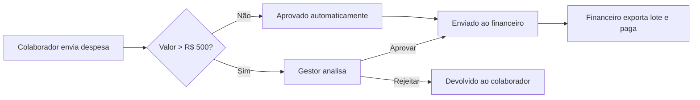
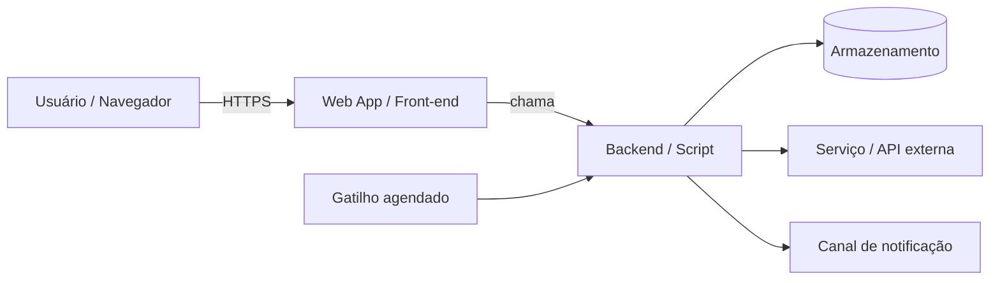
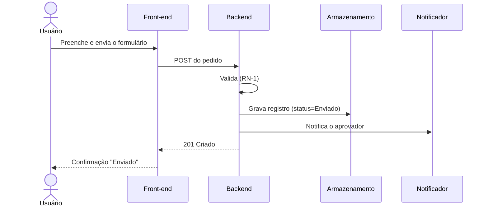

# 📘 Documentação Técnica — Portfólio Análise de Dados com ML

> **Documentação técnica "as-built" de `<NOME_DO_PROJETO>`, para o time.** Use este modelo para documentar uma ferramenta, sistema, automação ou serviço **que já foi construído** — de forma que a engenharia (e agentes de IA) entendam como ele funciona e consigam operar, manter e evoluir.

> 👥 **Público:** time técnico / mantenedores. Para o passo a passo voltado a **quem usa** a ferramenta, use o **Manual do Usuário** (documento irmão) — veja [§21](#21-guia-do-usuário).

Duplique este arquivo dentro do projeto (ex.: `docs/TECNICO.md` ou o `README` do repositório) e preencha cada `<PLACEHOLDER>`. O modelo é agnóstico ao tipo de projeto — serve para **SaaS · sistemas internos · APIs · automações · projetos de IA · apps mobile · aplicações web · infraestrutura**. Seções que não se aplicam devem ser marcadas como `Não se aplica — <motivo>`, em vez de apagadas, para que o leitor saiba que a omissão foi proposital.

| | |
|---|---|
| **Projeto** | Portfólio Análise de Dados com ML |
| **O que é (uma linha)** | Repositório de portfólio com plano de estudo e 4 projetos de análise de dados e ML (temas RH e suporte de TI) |
| **Processo / fluxo que atende** | Transição de carreira para analista de dados com ML: estudar → construir projeto → publicar no GitHub e no LinkedIn |
| **Status** | 🟡 Beta — estrutura criada, projetos a começar |
| **Responsável (accountable)** | Rafael Garcia (GitHub @RafaGarciaDev) |
| **Mantenedor(es)** | Rafael Garcia |
| **Versão** | 0.2.0 (`versao.py`, `pyproject.toml`, `CHANGELOG.md`) |
| **Última atualização** | 2026-10-28 por Claude Code |
| **URL de produção** | Não se aplica — portfólio, sem sistema no ar |
| **Código-fonte** | https://github.com/RafaGarciaDev/portfolio-dados-ml (cópia oficial; a pasta local é só cópia de trabalho) |

---

## 📐 Regras de Documentação

> ⚠️ **Leia antes de editar.** Estas regras mantêm este documento confiável conforme o sistema evolui.

1. **Este documento é a fonte única da verdade sobre como o sistema funciona hoje.** Quando o documento e o sistema em produção divergem, um dos dois está com bug — corrija o que estiver errado. Descreva a realidade, não intenções.
2. **A documentação é atualizada na mesma alteração que o código.** Qualquer mudança em comportamento, dados, configuração, deploy ou IDs só está completa quando este documento reflete a mudança. "Documentação atualizada" faz parte da definição de _pronto_.
3. **Nunca invente informação.** Não chute IDs, responsáveis, datas ou como uma funcionalidade se comporta. Se não foi verificado, não está documentado — é um `<TODO>`.
4. **Informação desconhecida é marcada como `<TODO>`, de forma visível.** Uma lacuna honesta vale mais que uma invenção confiante.
5. **Histórico nunca é apagado.** Designs e decisões substituídos são marcados como `Descontinuado` / `Substituído por <link>` e mantidos. O _porquê_ o sistema é assim importa tanto quanto o _que_ ele é.
6. **Decisões relevantes registram sua justificativa.** Capture _por que_ foi feito assim e o que foi descartado — veja [Decisões & Justificativas](#20-decisões--justificativas-adr).
7. **Toda funcionalidade que existe está documentada.** Se a ferramenta faz, está aqui. Se está aqui mas a ferramenta não faz, o status diz isso.
8. **Escrito para humanos _e_ para agentes de IA.** Seja explícito, estruturado e sem ambiguidade. Prefira tabelas e frases curtas e diretas. Um assistente de IA deve conseguir operar a partir deste documento sem precisar perguntar nada.

<details>
<summary>📎 Convenções — placeholders, status, callouts</summary>

**Placeholders** — substitua todos; mantenha visíveis os que ainda não foram resolvidos.

| Placeholder | Substituir por |
|---|---|
| `<NOME_DO_PROJETO>` | Nome oficial da ferramenta/sistema |
| `<RESPONSAVEL>` | Pessoa ou time accountable |
| `<AUTOR>` | Quem fez a edição |
| `<DATA>` | Data ISO `AAAA-MM-DD` |
| `<VERSAO>` | Versão semântica `MAIOR.MENOR.PATCH` |
| `<URL_PROD>` / `<URL_REPO>` | Links / locais |
| `<*_ID>` | Um identificador (script, deployment, planilha, projeto…) |
| `<AMBIENTE>` | Nome do ambiente (`dev`, `staging`, `prod`) |
| `<TODO>` | Ainda não conhecido — deve ficar visível |

**Badges de status** — use de forma consistente: `🟢 No ar` · `🟡 Beta` · `🔴 Descontinuado` · `⚫ Aposentado` · `✅ Funciona` · `🐛 Bug conhecido` · `⚠️ Pegadinha`

**Legenda dos callouts:**

> 🎯 **Propósito** — para que serve a seção.
> ✍️ **Como preencher** — o que escrever.
> ⚠️ **Importante** — uma ressalva ou regra.
> 💡 **Exemplo** — uma amostra pronta (geralmente recolhida).

</details>

---

## 🧭 Índice

**Parte I · O Que É**
[1. Visão Geral](#1-visão-geral) · [2. Propósito & Contexto](#2-propósito--contexto) · [3. Funcionalidades & Capacidades](#3-funcionalidades--capacidades) · [4. Usuários & Papéis](#4-usuários--papéis) · [5. O Processo Que Ela Atende](#5-o-processo-que-ela-atende)

**Parte II · Como Funciona**
[6. Visão Geral da Arquitetura](#6-visão-geral-da-arquitetura) · [7. Stack de Tecnologia](#7-stack-de-tecnologia) · [8. Componentes](#8-componentes) · [9. Dados & Armazenamento](#9-dados--armazenamento) · [10. Integrações](#10-integrações) · [11. Interfaces & Pontos de Entrada](#11-interfaces--pontos-de-entrada) · [12. Regras de Negócio & Lógica](#12-regras-de-negócio--lógica) · [13. Fluxos Principais](#13-fluxos-principais)

**Parte III · Configuração & Operação**
[14. Configuração & Identificadores](#14-configuração--identificadores) · [15. Ambiente & Segredos](#15-ambiente--segredos) · [16. Deploy & Release](#16-deploy--release) · [17. Tarefas Agendadas & Gatilhos](#17-tarefas-agendadas--gatilhos) · [18. Segurança, Autenticação & Permissões](#18-segurança-autenticação--permissões) · [19. Monitoramento, Logs & Erros](#19-monitoramento-logs--erros)

**Parte IV · Uso, Manutenção & Conhecimento**
[20. Decisões & Justificativas (ADR)](#20-decisões--justificativas-adr) · [21. Como Usar (Guia do Usuário)](#21-como-usar-guia-do-usuário) · [22. Rodar & Desenvolver Localmente](#22-rodar--desenvolver-localmente) · [23. Manutenção & Runbook](#23-manutenção--runbook) · [24. Troubleshooting & FAQ](#24-troubleshooting--faq) · [25. Limitações Conhecidas & Pegadinhas](#25-limitações-conhecidas--pegadinhas) · [26. Melhorias Futuras](#26-melhorias-futuras) · [27. Changelog](#27-changelog) · [28. Referências & Links](#28-referências--links)

---

# Parte I · O Que É

### 1. Visão Geral

> 🎯 **Propósito** — Fazer qualquer leitor entender o que é o sistema em menos de 30 segundos.
> ✍️ **Como preencher** — 3 a 5 frases descrevendo o que ele faz hoje, quem usa e o status atual. Escrito do ponto de vista do usuário, sem jargão.

> 💡 **Exemplo**
> _`<NOME_DO_PROJETO>` é um web app interno que permite aos 400 colaboradores de campo enviarem reembolsos de despesa com foto do comprovante. Substituiu um processo manual de planilha e e-mail. Os gestores aprovam no próprio app; o financeiro exporta os lotes aprovados. Está **🟢 No ar** desde `<DATA>` e processa ~120 pedidos/semana._

Repositório público de portfólio para a transição de carreira do suporte de TI para **analista de dados com ML**. Reúne o plano de estudo de 4 meses (`PLANO_DE_ESTUDO.md`), 4 projetos (`projetos/01` a `04`, temas RH e suporte de TI, só com dados públicos ou sintéticos) e os rascunhos de posts do LinkedIn (`linkedin/POSTS.md`). Status **🟡 Beta**: estrutura criada em 2026-10-28, projetos a começar.

---

### 2. Propósito & Contexto

> 🎯 **Propósito** — Por que este sistema existe e o que ele mudou.
> ✍️ **Como preencher** — Descreva a situação anterior, o que a ferramenta faz a respeito e o benefício. É contexto, não propaganda.

| Aspecto | Descrição |
|---|---|
| Problema / necessidade que resolve | `<TODO>` |
| Como funcionava antes | `<TODO — processo manual, ferramenta antiga, nada>` |
| O que a ferramenta faz a respeito | `<TODO>` |
| Benefício / o que melhorou | `<TODO — quantifique se possível: tempo economizado, erros reduzidos>` |
| Quem é dono do processo | `<TODO — a área/pessoa de negócio>` |

---

### 3. Funcionalidades & Capacidades

> 🎯 **Propósito** — A lista concreta do que o sistema faz hoje.
> ✍️ **Como preencher** — Uma capacidade por linha. O status reflete o que realmente está no ar, não o planejado.

| # | Funcionalidade | O que faz | Status |
|---|---|---|---|
| F1 | `<TODO>` | `<TODO>` | ✅ Funciona |
| F2 | `<TODO>` | `<TODO>` | 🟡 Beta |
| F3 | `<TODO>` | `<TODO>` | 🐛 Bug conhecido |

---

### 4. Usuários & Papéis

> 🎯 **Propósito** — Quem usa o sistema e em qual papel.
> ✍️ **Como preencher** — Liste cada tipo de usuário e o que faz. As permissões detalhadas ficam em [§18](#18-segurança-autenticação--permissões).

| Papel | Quem são | O que fazem no sistema |
|---|---|---|
| `<Usuário final>` | `<TODO>` | `<TODO>` |
| `<Aprovador / Gestor>` | `<TODO>` | `<TODO>` |
| `<Admin / Mantenedor>` | `<TODO>` | `<TODO>` |

---

### 5. O Processo Que Ela Atende

> 🎯 **Propósito** — O processo/fluxo real de negócio que a ferramenta atende. Muitas vezes é a razão inteira de ela existir.
> ✍️ **Como preencher** — Mapeie o fluxo de ponta a ponta e mostre onde a ferramenta entra. Um diagrama vale um parágrafo.

<details>
<summary>💡 Exemplo — fluxo do processo</summary>



</details>

| Etapa | Ator | Ação | Papel do sistema |
|---|---|---|---|
| 1 | `<TODO>` | `<TODO>` | `<registra / notifica / valida>` |
| 2 | `<TODO>` | `<TODO>` | `<TODO>` |

---

# Parte II · Como Funciona

### 6. Visão Geral da Arquitetura

> 🎯 **Propósito** — O modelo mental do que está de fato construído: as partes e como os dados fluem entre elas.
> ✍️ **Como preencher** — Comece com um diagrama do que realmente roda e depois uma narrativa curta. Nível: o que um novo mantenedor precisa no primeiro dia.

<details>
<summary>💡 Exemplo — arquitetura as-built</summary>



**Narrativa:** o front-end só fala com o backend. O backend é dono de todas as leituras/escritas no armazenamento, chama `<serviço externo>` e posta notificações em `<canal>`. Um gatilho agendado roda `<job>` a cada `<intervalo>`.

</details>

`<TODO — diagrama de arquitetura + narrativa>`

---

### 7. Stack de Tecnologia

> 🎯 **Propósito** — Com o que o sistema é realmente construído.
> ✍️ **Como preencher** — Fixe as versões reais. Explique o _porquê_ só onde a escolha não é óbvia (raciocínio mais profundo → [ADR](#20-decisões--justificativas-adr)).

| Camada | Tecnologia | Versão | Observações |
|---|---|---|---|
| Linguagem / runtime | Python | 3.12 | `pyproject.toml` (`requires-python >= 3.12`) |
| Framework / plataforma | Jupyter · SQLite · Power BI | `<TODO>` | Jupyter vem do `requirements.txt`; SQLite e Power BI são instalados à parte |
| Armazenamento | Arquivos CSV/SQLite dentro de cada `projetos/NN-*/` | — | Só dados públicos ou sintéticos (`REQUISITOS.md`) |
| Hospedagem | GitHub | — | https://github.com/RafaGarciaDev/portfolio-dados-ml |
| Bibliotecas / serviços-chave | pandas, numpy, matplotlib, seaborn, scikit-learn | sem versão fixada | `requirements.txt`; fixar versões quando o projeto 02 começar |
| Testes e lint | pytest, ruff | sem versão fixada | `requirements-dev.txt`; ruff com regras `E, F, I, B` |

---

### 8. Componentes

> 🎯 **Propósito** — Cada parte do sistema e por que ela é responsável.
> ✍️ **Como preencher** — Uma linha por grupo de arquivos / serviço / módulo. Aponte onde o código mora.

| Componente | Responsabilidade | Local (arquivo/caminho/serviço) | Depende de |
|---|---|---|---|
| `<Front-end>` | `<UI, entrada do usuário>` | `<TODO>` | Backend |
| `<Backend / lógica central>` | `<validação, persistência>` | `<TODO>` | Armazenamento |
| `<Módulo de notificação>` | `<envia alertas>` | `<TODO>` | Canal externo |

---

### 9. Dados & Armazenamento

> 🎯 **Propósito** — Onde os dados moram e como estão estruturados.
> ✍️ **Como preencher** — Liste cada local de armazenamento e depois a estrutura. Para ferramentas com **banco de dados**, documente tabelas/coleções. Para ferramentas com **planilha** (comum em automações), documente a aba e um **mapa de colunas** — as colunas exatas que o código lê/escreve.

**Locais de armazenamento**

| Armazenamento | Tipo | Guarda | ID / local |
|---|---|---|---|
| `<Principal>` | `<Banco / Planilha / bucket>` | `<quais dados>` | `<*_ID ou URL>` |
| `<Logs / auditoria>` | `<TODO>` | `<TODO>` | `<TODO>` |

<details>
<summary>💡 Exemplo — mapa de colunas de planilha</summary>

**Aba: `Pedidos`** (ID da planilha `<ID_PLANILHA>`)

| Col | Cabeçalho | Tipo | Escrito por | Observações |
|---|---|---|---|---|
| A | `Timestamp` | datetime | Envio do form | Automático |
| B | `Colaborador` | texto | Envio do form | — |
| C | `Valor` | número | Envio do form | — |
| D | `Status` | enum | Backend | `Enviado / Aprovado / Rejeitado` |
| E | `AprovadoPor` | texto | Backend | Preenchido na aprovação |

</details>

<details>
<summary>💡 Exemplo — entidade / tabela</summary>

**Tabela / entidade: `<Nome>`**

| Campo | Tipo | Restrições | Descrição |
|---|---|---|---|
| `id` | `UUID` | PK | Identificador único |
| `<campo>` | `<tipo>` | `<not null>` | `<TODO>` |

</details>

**Ciclo de vida dos dados**

| Tópico | Detalhe |
|---|---|
| Backups | `<frequência, local>` |
| Retenção | `<TODO>` |
| Campos sensíveis / PII | `<lista + como são protegidos>` |

---

### 10. Integrações

> 🎯 **Propósito** — Todo sistema externo com que a ferramenta conversa.
> ✍️ **Como preencher** — Anote direção, como conecta, autenticação e o que quebra se cair.

| Sistema | Direção | Como | Autenticação | Dados trocados | Se cair |
|---|---|---|---|---|---|
| `<Chat / e-mail>` | Saída | Webhook | `<HMAC / token>` | `<notificações>` | `<não envia alertas>` |
| `<API externa>` | Saída | REST | Chave de API | `<TODO>` | `<TODO>` |
| `<Origem de form / webhook>` | Entrada | Webhook | — | `<eventos>` | `<dados desatualizados>` |

> ⚠️ **Importante** — Documente o impacto de falha de cada integração; ele orienta o [monitoramento](#19-monitoramento-logs--erros) e o [troubleshooting](#24-troubleshooting--faq).

---

### 11. Interfaces & Pontos de Entrada

> 🎯 **Propósito** — Como o sistema é acionado — a "superfície pública".
> ✍️ **Como preencher** — Cubra o que se aplicar: rotas web, endpoints de API, funções acionadas, comandos de CLI, handlers de evento. Aponte para uma spec formal (OpenAPI/GraphQL) se existir.

| Tipo | Nome / Caminho | Acionado por | O que faz | Autenticação |
|---|---|---|---|---|
| Rota | `<GET /dashboard>` | Usuário | `<renderiza o painel>` | Sessão |
| Endpoint | `<POST /v1/x>` | Cliente | `<cria x>` | Bearer |
| Função | `<doPost(e)>` | Webhook / form | `<trata o envio>` | — |
| Handler de evento | `<onFormSubmit>` | Evento de form | `<TODO>` | — |

<details>
<summary>💡 Exemplo — especificação de endpoint</summary>

**`POST /v1/pedidos`** — Cria um pedido.

_Requisição_ `{ "valor": 42.50, "categoria": "viagem" }`

| Código | Significado | Corpo |
|---|---|---|
| `201` | Criado | `{ "id": "ped_1", "status": "enviado" }` |
| `400` | Erro de validação | `{ "erro": "valor deve ser positivo" }` |
| `401` | Não autenticado | `{ "erro": "token inválido" }` |

</details>

---

### 12. Regras de Negócio & Lógica

> 🎯 **Propósito** — As regras de domínio e decisões que o sistema aplica. São as respostas para "por que ele faz isso?".
> ✍️ **Como preencher** — Escreva cada regra como um invariante. Aponte onde ela é aplicada no código.

| ID | Regra | Onde é aplicada | Fonte / motivo |
|---|---|---|---|
| RN-1 | `<Pedidos acima de R$ 500 exigem aprovação do gestor>` | `<arquivo/função>` | Política financeira |
| RN-2 | `<A janela de aprovação trava após o dia 25>` | `<arquivo/função>` | `<TODO>` |
| RN-3 | `<TODO>` | `<TODO>` | `<TODO>` |

---

### 13. Fluxos Principais

> 🎯 **Propósito** — Passo a passo do que realmente acontece nas operações mais importantes.
> ✍️ **Como preencher** — Documente de 2 a 4 fluxos centrais de ponta a ponta (ex.: "ao enviar", "ao aprovar", "sincronização noturna"). Um diagrama de sequência ajuda em fluxos com vários atores.

<details>
<summary>💡 Exemplo — sequência do "ao enviar"</summary>



</details>

**Fluxo: `<nome>`**

1. `<Gatilho — o que inicia>`
2. `<Passo>`
3. `<Passo>`
4. `<Resultado / estado final>`

---

# Parte III · Configuração & Operação

### 14. Configuração & Identificadores

> 🎯 **Propósito** — Os IDs, chaves e ajustes necessários para localizar, rodar e atualizar o sistema. É o que um mantenedor consulta primeiro.
> ✍️ **Como preencher** — Preencha cada identificador. **IDs não secretos** ficam aqui; **segredos** vão para [§15](#15-ambiente--segredos), apenas como placeholders.

| Item | Valor |
|---|---|
| URL de produção | `<URL_PROD>` |
| Local do código-fonte | `<URL_REPO / caminho>` |
| ID do projeto / app | `<ID_PROJETO>` |
| ID de deployment / release (PROD) | `<ID_DEPLOY>` |
| ID(s) do armazenamento | `<ID_PLANILHA / NOME_BANCO>` |
| Local do arquivo de config | `<caminho do config.js / .env.example>` |

**Ajustes configuráveis** (comportamento sem mexer no código)

| Ajuste | Onde é definido | Padrão | Observações |
|---|---|---|---|
| `<FEATURE_X_ATIVA>` | `<config>` | `false` | `<TODO>` |
| `<DRY_MODE>` | `<config>` | `true` | `<virar para false antes do go-live>` |

---

### 15. Ambiente & Segredos

> 🎯 **Propósito** — Inventário dos valores de ambiente e segredos — sem expô-los.
> ✍️ **Como preencher** — Nome, propósito e um **placeholder de exemplo** para cada. Mantenha em sincronia com `.env.example` / propriedades do script.

| Variável | Propósito | Obrigatória | Exemplo (placeholder) | Segredo? |
|---|---|:---:|---|:---:|
| `<DATABASE_URL>` | Conexão com o armazenamento | ✅ | `postgres://user:<senha>@host/db` | 🔒 |
| `<WEBHOOK_URL>` | Destino das notificações | ✅ | `https://.../<OCULTO>` | 🔒 |
| `<API_KEY_X>` | Autenticação com `<serviço>` | ✅ | `<OCULTO>` | 🔒 |
| `<LOG_LEVEL>` | Verbosidade | — | `info` | — |

> ⚠️ **Importante** — Os valores reais dos segredos ficam **apenas** no cofre de segredos / propriedades do script de cada `<AMBIENTE>`, nunca neste documento nem no código.

---

### 16. Deploy & Release

> 🎯 **Propósito** — Como publicar uma mudança em produção, com segurança.
> ✍️ **Como preencher** — Dê os **comandos/passos exatos**, os ambientes e como reverter. Esta é a seção que as pessoas copiam e colam sob pressão.

**Ambientes**

| Ambiente | URL | Deploy a partir de | Como |
|---|---|---|---|
| `dev` | `<URL>` | `<branch>` | `<TODO>` |
| `prod` | `<URL_PROD>` | `<branch/tag>` | `<TODO>` |

**Passos do deploy**

```bash
# <TODO — os comandos reais>
```

<details>
<summary>💡 Exemplos — fluxo via git e via clasp (Apps Script)</summary>

```bash
# Release baseado em git / CI
git tag v1.2.0 && git push --tags   # o CI builda e publica em prod

# Google Apps Script (clasp) — envia o código e atualiza o deployment de PROD
clasp push
clasp deploy -i <ID_DEPLOY_PROD>    # atualiza o web app no ar
```

</details>

**Rollback**

```bash
# <TODO — como voltar para o último release bom conhecido>
```

> 💡 **Dica** — Documente o caminho de rollback _antes_ de precisar dele, não durante um incidente.

---

### 17. Tarefas Agendadas & Gatilhos

> 🎯 **Propósito** — Tudo que roda automaticamente, sem ninguém clicar.
> ✍️ **Como preencher** — Liste gatilhos por tempo e por evento, o que rodam e como foram instalados.

| Gatilho | Tipo | Roda | Frequência / evento | Instalado como |
|---|---|---|---|---|
| `<sincronizacaoDiaria>` | Por tempo | `<função/job>` | `<diário 06:00>` | `<código / console>` |
| `<onFormSubmit>` | Por evento | `<handler>` | Ao enviar o form | `<gatilho instalável>` |

> ⚠️ **Importante** — Anote se algum gatilho precisa ser (re)criado manualmente após um redeploy ou troca de dono.

---

### 18. Segurança, Autenticação & Permissões

> 🎯 **Propósito** — Como a identidade é estabelecida e quem pode fazer o quê.
> ✍️ **Como preencher** — Cubra autenticação, o modelo de autorização e uma matriz papel→capacidade. Anote o básico de proteção de dados.

| Tópico | Detalhe |
|---|---|
| Autenticação | `<SSO / OAuth / sessão / chave de API / executar-como>` |
| Quem pode acessar | `<restrito ao domínio / público / lista de permitidos>` |
| Modelo de autorização | `<RBAC / por dono / ABAC>` |
| Classificação dos dados | `<interno / confidencial / regulado>` |
| Criptografia | `<em trânsito / em repouso>` |
| Armazenamento de segredos | `<cofre / propriedades do script — nunca no código>` |

**Matriz de permissões**

| Capacidade | Usuário | Aprovador | Admin |
|---|:---:|:---:|:---:|
| Ver os próprios registros | ✅ | ✅ | ✅ |
| Aprovar / rejeitar | — | ✅ | ✅ |
| Gerenciar config e usuários | — | — | ✅ |

---

### 19. Monitoramento, Logs & Erros

> 🎯 **Propósito** — Como saber que está saudável, onde olhar quando não está e como o sistema falha.
> ✍️ **Como preencher** — Cubra o que é logado e onde, quaisquer alertas e o comportamento nas falhas comuns.

**Logs & monitoramento**

| Tópico | Detalhe |
|---|---|
| Onde ficam os logs | `<agregador / console / planilha + URL>` |
| Formato e níveis | `<JSON estruturado · error/warn/info>` |
| Sinal de saúde / alerta | `<o que dispara um alerta, para qual canal>` |
| Dashboards / status | `<URL>` |

**Tratamento de erros**

| Cenário | Comportamento do sistema | O usuário vê | Recuperação |
|---|---|---|---|
| Erro de validação | Rejeita, sem alterar nada | Mensagem inline | Corrigir a entrada |
| Falha de serviço externo | Retry / log + alerta | Erro amigável + ID de referência | Automático / manual |
| Exceção não tratada | Log + fallback seguro | Erro genérico + ID de referência | Investigar |

> 💡 **Princípio** — Nunca logue segredos nem PII sem mascarar. Dê ao usuário um ID de referência que ele possa citar, não um stack trace.

---

# Parte IV · Uso, Manutenção & Conhecimento

### 20. Decisões & Justificativas (ADR)

> 🎯 **Propósito** — Por que o sistema foi feito do jeito que é. Preserva o raciocínio para que mudanças futuras não repitam erros do passado.
> ✍️ **Como preencher** — Uma entrada por decisão relevante. **Nunca edite uma decisão registrada** — substitua-a por uma nova e ligue as duas.

> ⚠️ **Importante** — Registre a decisão _e as alternativas rejeitadas_. O "por que não X?" costuma ser a parte mais valiosa.

<details>
<summary>💡 Modelo de ADR — copie para cada decisão</summary>

**ADR-000N — `<Título curto>`**

| | |
|---|---|
| **Status** | Aceita · Descontinuada · Substituída pela ADR-00XX |
| **Data** | `<DATA>` |
| **Decisores** | `<nomes>` |

**Contexto** — Qual situação/restrição motivou a decisão.
**Decisão** — O que foi escolhido, de forma direta.
**Alternativas consideradas** — Opções e por que cada uma foi rejeitada.
**Consequências** — O que ficou mais fácil, o que ficou mais difícil e o trade-off aceito.

</details>

| ADR | Título | Status | Data |
|---|---|---|---|
| ADR-0001 | Foco em análise de dados + ML clássico; deep learning e LLMs ficam para uma fase 2. Motivo: as vagas de analista pedem SQL, Python, Power BI e scikit-learn; abrir demais atrasa os projetos. | Aceita | 2026-10-28 |
| ADR-0002 | Temas de RH e suporte de TI. Motivo: é o domínio que o autor conhece e consegue defender em entrevista. Descartado: datasets genéricos (ex.: Titanic), que não diferenciam. | Aceita | 2026-10-28 |
| ADR-0003 | Só dados públicos ou sintéticos. Motivo: repositório público e LGPD; dado real da empresa nunca sobe. | Aceita | 2026-10-28 |
| ADR-0004 | Pasta local em `Documents\` em vez do disco `D:\` dos labs. Motivo: o `D:\` não estava conectado em 2026-10-28; o GitHub é a cópia oficial, então mover depois não perde nada. | Aceita | 2026-10-28 |

---

### 21. Guia do Usuário

> 🎯 **Propósito** — O passo a passo para quem _usa_ a ferramenta.
> ✍️ **Como preencher** — O guia completo do usuário final vive em um documento separado — o **Manual do Usuário** — escrito sem jargão e orientado a tarefas. Aqui, só aponte para ele (não duplique, para não desatualizar).

| Recurso | Link |
|---|---|
| Manual do Usuário | [MANUAL.md](MANUAL.md) |
| Vídeos / treinamento | `<TODO>` |

> 💡 Regra prática: passo a passo mora **só** no Manual; esta seção é apenas o ponteiro.

---

### 22. Rodar & Desenvolver Localmente

> 🎯 **Propósito** — Como um dev coloca o projeto para rodar para corrigir ou estender.
> ✍️ **Como preencher** — Pré-requisitos, setup, execução e testes — como comandos prontos para copiar e colar.

**Pré-requisitos:** Python 3.12+, git. Opcional: Power BI Desktop (projeto 02) e DB Browser for SQLite (projeto 01).

```bash
# Setup
git clone https://github.com/RafaGarciaDev/portfolio-dados-ml.git && cd portfolio-dados-ml
python -m venv .venv
.venv\Scripts\activate
pip install -r requirements-dev.txt        # testes e lint
pip install -r requirements.txt            # bibliotecas de análise (a partir do projeto 02)

# Configurar
# Não se aplica — sem variáveis de ambiente por enquanto

# Rodar
jupyter notebook                           # abrir os notebooks de cada projeto

# Testar
python -m pytest -q
ruff check .
ruff format --check .
```

---

### 23. Manutenção & Runbook

> 🎯 **Propósito** — Tarefas operacionais recorrentes e como executá-las.
> ✍️ **Como preencher** — As rotinas e tarefas ocasionais necessárias para manter o sistema no ar.

| Tarefa | Quando | Como | Responsável |
|---|---|---|---|
| `<Rotacionar chave de API>` | `<A cada 90 dias>` | `<passos / link>` | `<TODO>` |
| `<Reinstalar gatilhos>` | `<Após redeploy>` | `<rodar função de setup>` | `<TODO>` |
| `<Arquivar dados antigos>` | `<Anual>` | `<TODO>` | `<TODO>` |
| `<Restaurar de backup>` | `<Em perda de dados>` | `<link do procedimento>` | `<TODO>` |

---

### 24. Troubleshooting & FAQ

> 🎯 **Propósito** — Respostas rápidas para "quebrou / está estranho".
> ✍️ **Como preencher** — Sintoma → causa provável → correção. Alimente com base em incidentes reais.

| Sintoma | Causa provável | Correção |
|---|---|---|
| `<Notificações não saem>` | `<URL do webhook mudou / foi rotacionada>` | `<atualizar WEBHOOK_URL, redeploy>` |
| `<Erro "É necessária autorização">` | `<dono do gatilho mudou>` | `<rodar setup novamente como o dono>` |
| `<Dados desatualizados / faltando>` | `<job de sync falhou>` | `<checar logs, rodar o job de novo>` |
| `<TODO>` | `<TODO>` | `<TODO>` |

---

### 25. Limitações Conhecidas & Pegadinhas

> 🎯 **Propósito** — O que o sistema deliberadamente _não_ faz e as armadilhas a conhecer.
> ✍️ **Como preencher** — Restrições honestas e comportamentos não óbvios. Poupa horas de quem vier depois.

| ⚠️ | Limitação / pegadinha | Impacto | Contorno |
|---|---|---|---|
| ⚠️ | `<Só aceita um arquivo por envio>` | `<TODO>` | `<TODO>` |
| ⚠️ | `<Roda como a conta do implantador, não a do usuário>` | `<TODO>` | `<TODO>` |
| ⚠️ | `<TODO>` | `<TODO>` | `<TODO>` |

---

### 26. Melhorias Futuras

> 🎯 **Propósito** — Ideias conhecidas e trabalho adiado — para não se perderem.
> ✍️ **Como preencher** — Lista enxuta; o rastreador de issues é a fonte da verdade. Não é compromisso, é memória.

| Ideia | Por que / valor | Prioridade | Link |
|---|---|---|---|
| `<TODO>` | `<TODO>` | `<Seria bom ter>` | `<issue>` |
| `<TODO>` | `<TODO>` | `<Deveria ter>` | `<issue>` |

---

### 27. Changelog

> 🎯 **Propósito** — Um histórico legível das mudanças relevantes.
> ✍️ **Como preencher** — O histórico completo fica **só** no [`CHANGELOG.md`](../CHANGELOG.md) da raiz (regra da skill `registrar-changelog-do-projeto`). Aqui, apenas a versão atual e o link — não duplicar entradas.

**Versão atual:** 0.2.0 — 2026-10-28 · histórico completo em [`CHANGELOG.md`](../CHANGELOG.md).

---

### 28. Referências & Links

> 🎯 **Propósito** — Um lugar só para achar tudo o que este documento aponta.
> ✍️ **Como preencher** — Mantenha os links atualizados; um link quebrado é um `<TODO>`.

| Recurso | Link |
|---|---|
| URL de produção | `<URL_PROD>` |
| Código-fonte | `<URL_REPO>` |
| Rastreador de issues / board | `<URL>` |
| Armazenamento(s) | `<URL / ID>` |
| Arquivos de design | `<URL>` |
| Logs / monitoramento | `<URL>` |
| Documentos relacionados | `<URL>` |
| Glossário | `<termos>` |

---

<div align="center">

**Fim do modelo.** · Documente a realidade, mantenha atualizado. · Última atualização `<DATA>` por `<AUTOR>`

</div>
